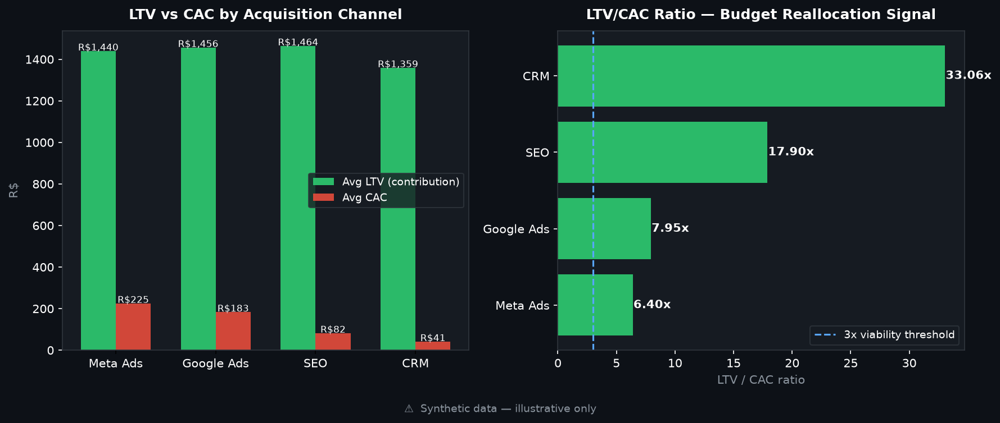
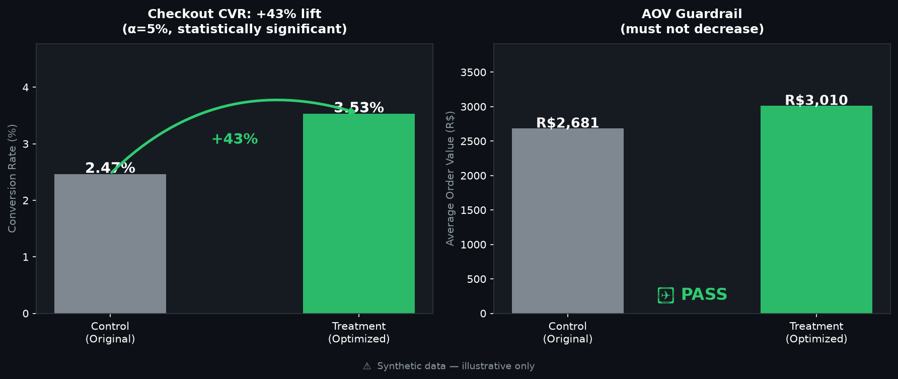

# E-Commerce Growth Analytics — Omnichannel Furniture Retail
## A Data-Driven Growth System Built from Scratch as Co-Founder

> ⚠️ **All data in this repository is fully synthetic**, generated to illustrate methodology. No real customer, transaction, or media data is used. Parameters are calibrated against published benchmarks for Brazilian omnichannel furniture retail.

[](https://python.org)
[](LICENSE)

---

## Context

From 2013 to 2020, I co-founded and scaled **InterCasa Móveis** — an omnichannel furniture retailer (~30 employees, multi-million R$ revenue) in São Paulo. As the sole executive layer responsible for P&L, marketing, and technology, I built the entire analytics stack from scratch: no data team, no external consultancy.

This repository documents the three analytical frameworks that drove measurable growth:

| Framework | Business Impact |
|-----------|----------------|
| Customer LTV & RFM Segmentation | Identified highest-payback cohorts for media reinvestment |
| A/B Checkout Optimization | ~13% conversion lift → ~R$280K incremental revenue/year |
| Media Mix Optimization | LTV-informed Google Ads + Meta reallocation → ~1/3 of cumulative ~29% revenue growth |

---

## The Challenge: Analytics Without Infrastructure

Furniture e-commerce breaks standard subscription models:
- **High ticket, low frequency:** average order ~R$2,400; customers buy 1–3 times in a lifetime
- **Long consideration cycle:** 2–8 weeks from first visit to purchase
- **Multi-touch, multi-device:** desktop research → mobile browse → desktop convert
- **Installment-driven:** Brazilian consumers need per-installment price visible upfront

Standard CPA optimization ignores all of this. The frameworks here are designed for the **economics of high-ticket, low-frequency retail**.

---

## Results at a Glance





## Notebooks

### [01 · Customer LTV & RFM Segmentation](notebooks/01_customer_ltv_rfm_furniture.ipynb)
RFM segmentation adapted for furniture (recency in months, frequency 1–3x lifetime). LTV/CAC ratio by acquisition channel reveals where to reinvest media budget. Champions segment: small % of customers, large % of revenue.

**Key finding:** CRM and SEO produce 2–3× higher LTV/CAC than paid social at equivalent volume — the natural reallocation target.

### [03 · A/B Checkout Optimization](notebooks/03_ab_checkout_optimization.ipynb)
50/50 experiment (Google Optimize) on checkout flow: simplified installment display, reduced steps, trust signals. Statistical design: α=5% bilateral, power=80%. Guardrail: average order value.

**Key finding:** ~13% conversion lift with AOV maintained → ~R$280K annualized at observed traffic, zero additional media spend.

### [05 · Media Mix Optimization](notebooks/05_media_mix_optimization.ipynb)
MMM with geometric adstock and Hill saturation curves for Google Ads + Meta (R$300–500K/year, 2015–2019). Marginal ROAS by channel, budget optimization via constrained minimization.

**Key finding:** Google Ads saturates earlier (high search competition in furniture); reallocation of ~10pp to Meta improved total portfolio ROAS at the same budget.

---

## Why This Matters for E-Commerce Platforms

The analytical challenges of furniture retail — high ticket, low frequency, long consideration cycle, installment economics — are structurally similar to what e-commerce platforms face when optimizing for **merchant health** rather than raw GMV:

| Furniture Retail | E-Commerce Platform |
|-----------------|---------------------|
| LTV/CAC by acquisition channel | Merchant LTV by acquisition segment |
| Checkout conversion rate | Merchant activation rate |
| Media mix attribution | Growth investment allocation |
| RFM segmentation | Merchant health scoring |

The frameworks transfer directly — only the unit of analysis changes (from consumer to merchant).

---

## Technical Stack

| Layer | Tools |
|-------|-------|
| Data | Python · Pandas · NumPy |
| Modeling | Statsmodels (OLS/MMM) · SciPy (optimization, hypothesis testing) |
| Experiment Design | SciPy (power analysis, two-proportion z-test) |
| Visualization | Matplotlib · Seaborn |

---

## Getting Started

```bash
git clone https://github.com/brunopamplona/intercasa-retail-growth-analytics.git
cd intercasa-retail-growth-analytics
pip install -r requirements.txt
jupyter lab
```

---

## Author

**Bruno Pamplona**  
Co-Founder & Growth Scientist (InterCasa, 2013–2020) | Lead Decision & Growth Scientist (Accenture, 2020–present)  
Causal Inference · LTV/CAC · Experimentation · MMM · E-Commerce Analytics

[LinkedIn](https://www.linkedin.com/in/brunopamplona) · [GitHub](https://github.com/brunopamplona)
